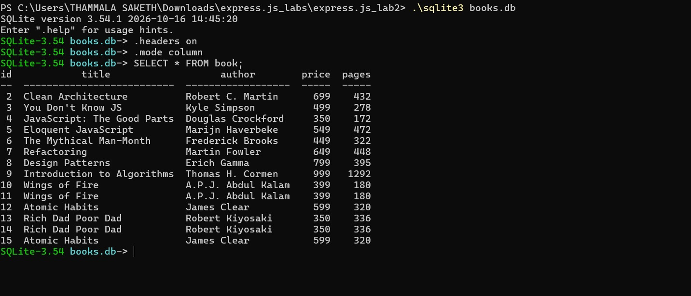
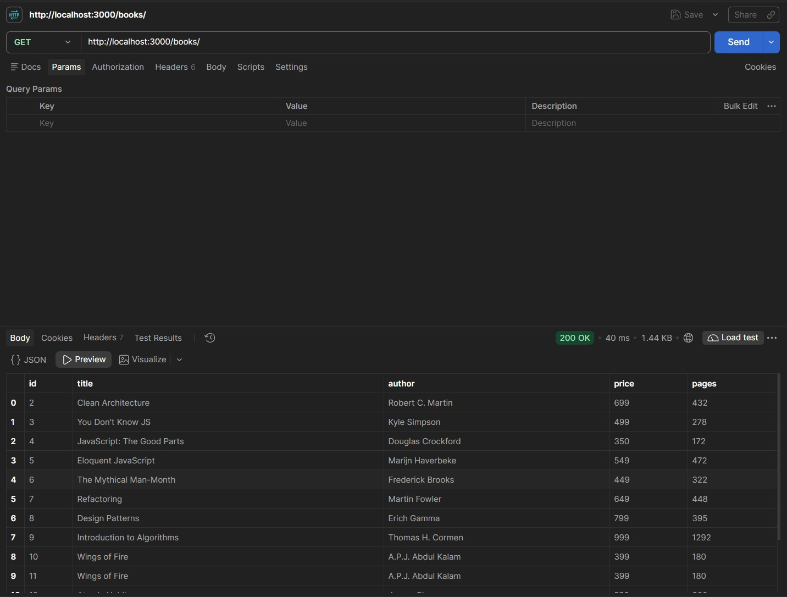
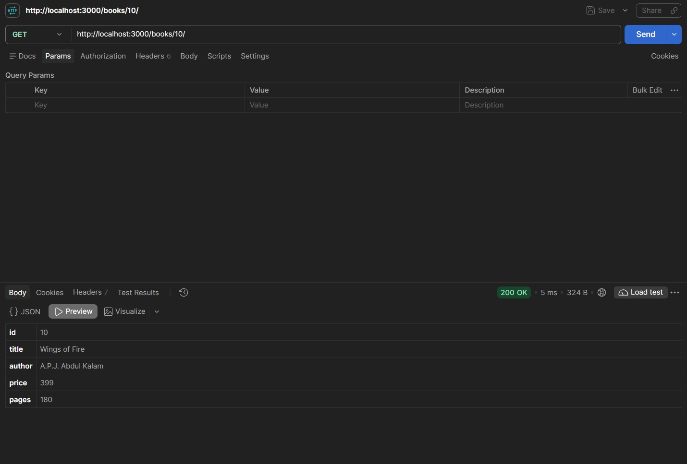
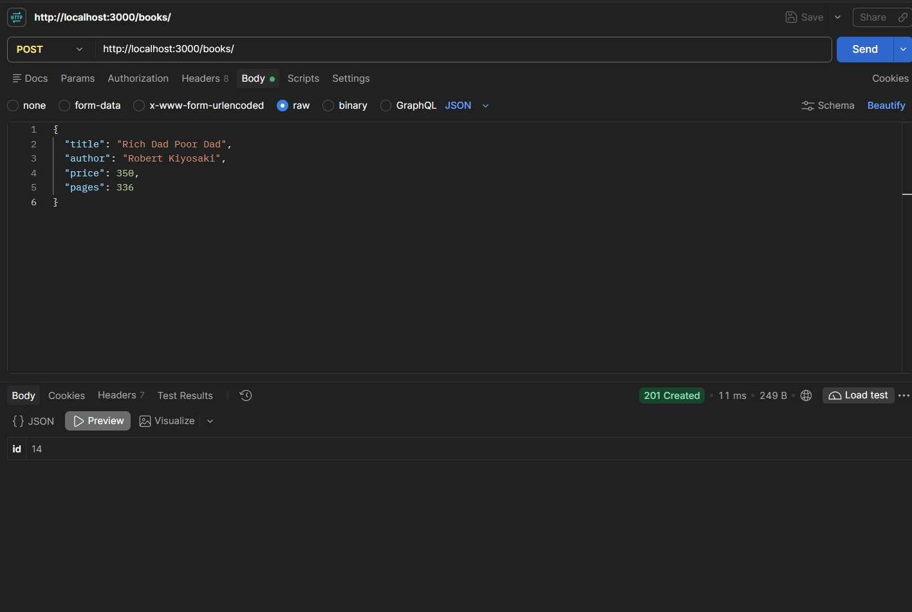
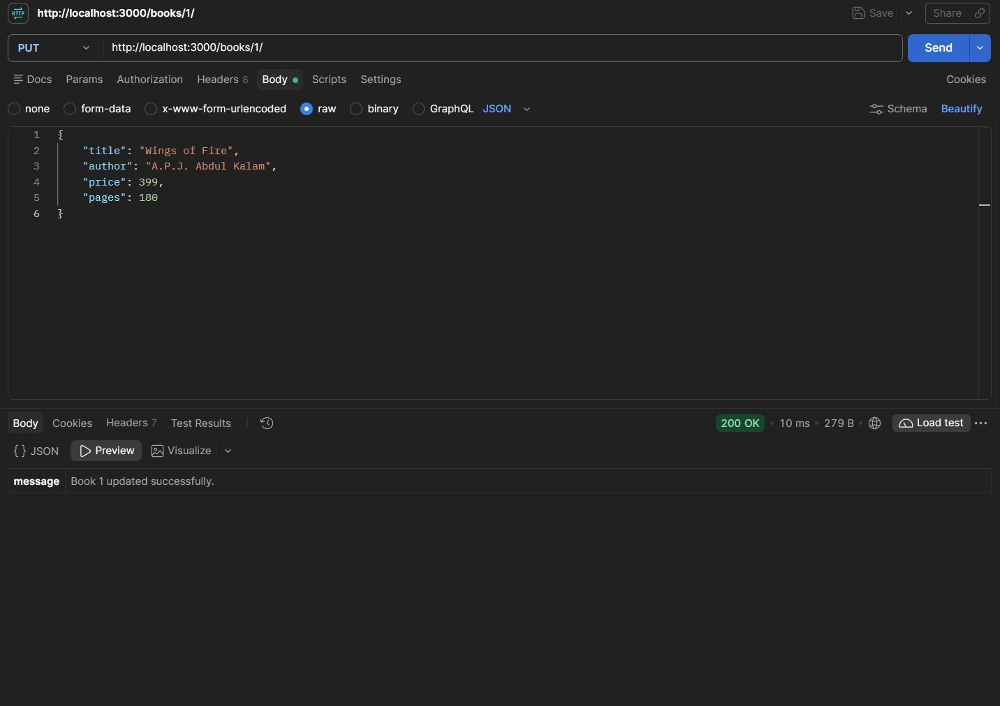
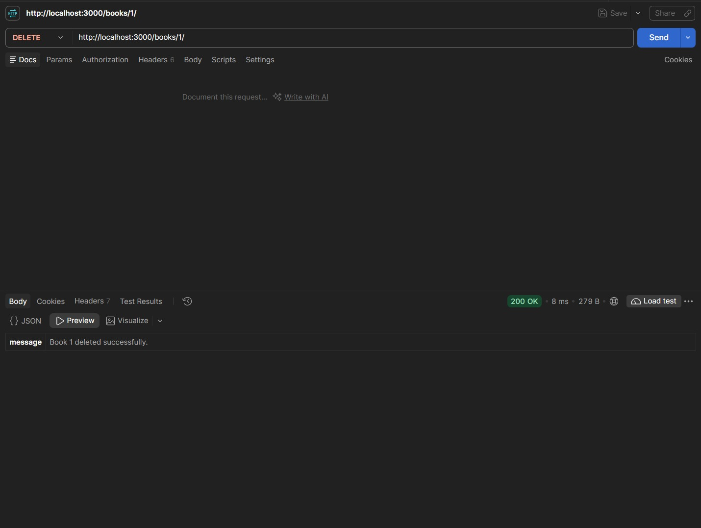
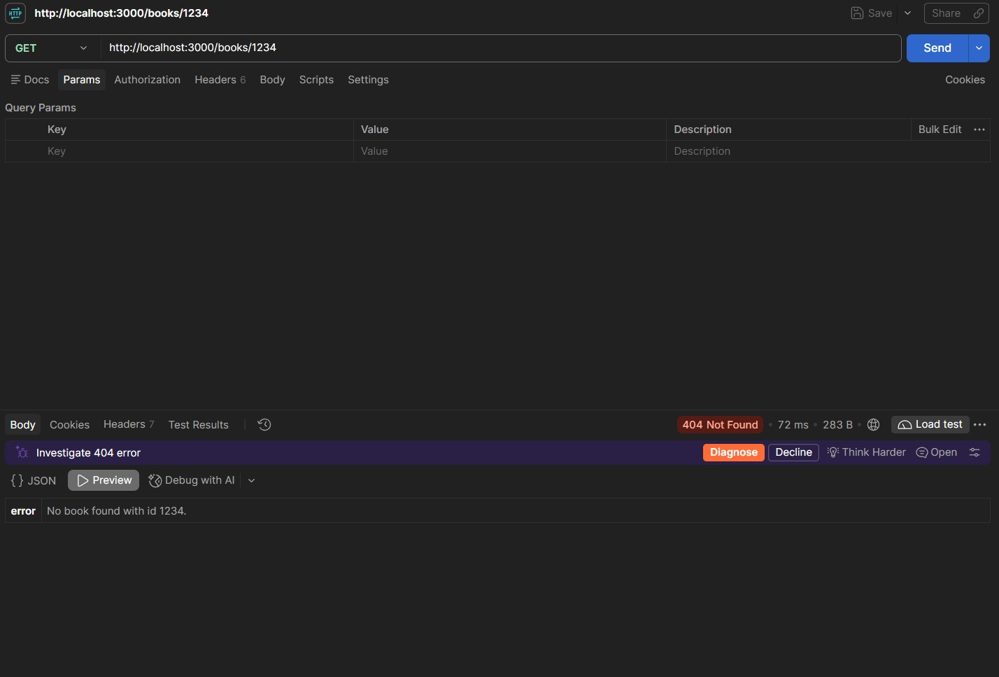

# Lab 2: SQLite database and CRUD routes

## Student Details

- **Name:** THAMMALA SAKETH
- **Registration Number:** 252U1R7090
- **Section:** CSE FSD - [2B]
- **Course:** Backend Development Fundamentals
- **Lab Number:** 02

## Live Link

Deployment pending — SQLite requires a writable filesystem and a persistent Node.js process. Vercel runs Express as serverless functions with a read-only filesystem, so SQLite writes do not work there. The recommended platform is **Render** (free plan), which provides a persistent server and a writable disk. The `sqlite3` native module also installs correctly on Render. Note: on Render's free plan the server sleeps after 15 minutes of inactivity and the database resets on every restart (because the disk is ephemeral on the free tier). A live URL will be added here only after deployment is authorised and all five endpoints have been confirmed working.

## Objective

Connect an Express server to a SQLite database and expose create, read, update and delete operations over HTTP.

## Technologies Used

- Node.js
- Express.js
- SQLite (via `sqlite` and `sqlite3` packages)
- JavaScript
- npm
- nodemon (development only)
- Visual Studio Code

## Project Structure

```text
express.js_lab2/
├── screenshots/
│   ├── cli-before.png
│   ├── get-all.png
│   ├── get-one.png
│   ├── post.png
│   ├── put.png
│   ├── delete.png
│   ├── not-found.png
│   └── cli-after.png
├── server.js
├── seed.sql
├── package.json
├── package-lock.json
├── .gitignore
└── README.md
```

> `books.db` is generated locally from `seed.sql` and is excluded from Git (see Git Notes below).

## package.json Fields Explained

| Field | Description |
|---|---|
| `name` | The name of the project (`lab-02`) |
| `version` | Current version of the project (`1.0.0`) |
| `description` | A short description of the project |
| `main` | The entry point of the application (`server.js`) |
| `scripts` | Defines shorthand commands; `start` runs `node server.js`, `dev` runs `nodemon server.js` |
| `author` | The developer's name |
| `license` | The open-source license type (`ISC`) |
| `dependencies` | Runtime packages: `express` (web framework), `sqlite` (promise-based wrapper), `sqlite3` (native SQLite driver) |
| `devDependencies` | Development-only packages: `nodemon` (auto-restarts the server when files change) |

## Installation and How to Run

### Prerequisites

- Node.js and npm installed
- Visual Studio Code or another code editor

### Steps to Run

1. Clone the repository or download the project.
2. Open the project folder in the terminal.
3. Install the dependencies:

   ```bash
   npm install
   ```

4. Build the database from `seed.sql` (required on first run):

   ```bash
   sqlite3 books.db < seed.sql
   ```

   > If the `sqlite3` CLI is not available, you can build the database with Node.js:
   > ```bash
   > node -e "const s=require('sqlite3');const{open}=require('sqlite');const fs=require('fs');(async()=>{const db=await open({filename:'./books.db',driver:s.Database});await db.exec(fs.readFileSync('./seed.sql','utf8'));await db.close();console.log('Database ready.');})()"
   > ```

5. Start the Express server:

   ```bash
   npm start
   ```

6. The server listens at `http://localhost:3000`.

### To Run in Development Mode (auto-restart on file change)

```bash
npm run dev
```

> Stop any running server with `Ctrl + C` before starting a new one on the same port.

## Database

### Table Definition

```sql
book(id INTEGER PRIMARY KEY, title TEXT, author TEXT, price INTEGER, pages INTEGER)
```

| Column | Type | Description |
|---|---|---|
| `id` | INTEGER PRIMARY KEY | Unique identifier; auto-assigned by SQLite |
| `title` | TEXT | Title of the book |
| `author` | TEXT | Author's name |
| `price` | INTEGER | Price in rupees (whole number) |
| `pages` | INTEGER | Number of pages |

### How to Rebuild the Database

```bash
sqlite3 books.db < seed.sql
```

This drops and recreates the `book` table and inserts all 10 starting rows.

### How to Inspect with the SQLite CLI

```bash
sqlite3 books.db
.headers on
.mode column
SELECT * FROM book;
```

To exit the SQLite CLI: type `.quit` and press Enter.

## Endpoints

| Method | Path | Description | Success Status |
|---|---|---|---|
| GET | `/books/` | Returns all books | 200 |
| GET | `/books/:bookId/` | Returns one book by id | 200 |
| POST | `/books/` | Adds a new book from the JSON body | 201 |
| PUT | `/books/:bookId/` | Updates all fields of an existing book | 200 |
| DELETE | `/books/:bookId/` | Deletes a book | 200 |

All routes work both with and without a trailing slash.

### Request Body (POST and PUT)

```json
{
  "title": "The Pragmatic Programmer",
  "author": "David Thomas",
  "price": 799,
  "pages": 352
}
```

### Error Responses

| Case | Status Code |
|---|---|
| `bookId` is not a positive whole number | 400 |
| Missing or invalid field in the body, or malformed JSON | 400 |
| No book with that id (GET one, PUT, DELETE) | 404 |
| Unknown route | 404 |
| Unexpected database error | 500 |

Every SQL query that uses input from the request uses `?` placeholders. User input is never joined into a SQL string.

## Screenshots

### 1. Database Before Testing (SQLite CLI)

Run `sqlite3 books.db`, then `.headers on`, `.mode column`, `SELECT * FROM book;` to show all 10 starting rows.



### 2. GET All Books (200 OK)

Send `GET http://localhost:3000/books/` in Postman or Thunder Client.



### 3. GET One Book (200 OK)

Send `GET http://localhost:3000/books/1/` to retrieve book with id 1.



### 4. POST Add a Book (201 Created)

Send `POST http://localhost:3000/books/` with a JSON body containing `title`, `author`, `price`, `pages`.



### 5. PUT Update a Book (200 OK)

Send `PUT http://localhost:3000/books/1/` with a JSON body containing updated values for all four fields.



### 6. DELETE a Book (200 OK)

Send `DELETE http://localhost:3000/books/1/` to remove book with id 1.



### 7. Error Case — Book Not Found (404)

Send `GET http://localhost:3000/books/9999/` with an id that does not exist.



### 8. Database After Testing (SQLite CLI)

Run the same SELECT to show the database state after all tests are complete.


## HTTP Status Codes

| Status Code | Meaning | Used For |
|---|---|---|
| `200 OK` | Request was successful | GET all, GET one, PUT, DELETE |
| `201 Created` | A new resource was created | POST (new book added) |
| `400 Bad Request` | Invalid input from the client | Non-integer `bookId`, missing or invalid body field, malformed JSON |
| `404 Not Found` | The requested resource does not exist | Book id not in database, unknown route |
| `500 Internal Server Error` | Unexpected error on the server side | Unhandled database errors |

## Viva Questions and Answers

> These questions were written by the student for Lab 2. Topics chosen: SQL injection and `?` placeholders, PUT vs POST, why 201 is used for POST, and what a PRIMARY KEY is.

### 1. What is SQL injection and how do `?` placeholders prevent it?

SQL injection is an attack where a user sends malicious text in a request that gets embedded directly into a SQL query, changing what the query does. For example, if the code did `"SELECT * FROM book WHERE id = " + bookId` and a user sent `bookId = "1 OR 1=1"`, the query would return all rows instead of one.

Using `?` placeholders with the `sqlite` package prevents this: the query and the data are sent to SQLite as separate items. SQLite treats the `?` value as pure data, never as SQL syntax, so no injection is possible. In this lab, every query that uses input looks like `db.get("SELECT * FROM book WHERE id = ?", [bookId])`.

### 2. What is the difference between PUT and POST?

POST creates a new resource. When a client sends `POST /books/`, the server inserts a new row and returns `201 Created` along with the new id. The client does not know the id in advance.

PUT replaces an existing resource identified by the URL. When a client sends `PUT /books/3/`, the server updates all four fields of book with id 3. The client already knows the id. In this lab, PUT updates all fields at once (a full replacement), not just some of them.

### 3. Why does POST return status code 201 instead of 200?

`200 OK` means the request succeeded and the response contains the requested data. `201 Created` is more precise: it means a new resource was successfully created as a result of the request. Using `201` tells the client clearly that something new was added to the database, not just that the request was handled. The HTTP standard reserves `201` specifically for responses to POST requests that create a new resource.

### 4. What is a PRIMARY KEY in SQLite?

A PRIMARY KEY is a column (or set of columns) whose value uniquely identifies each row in a table. In this lab, `id INTEGER PRIMARY KEY` means:
- Every book must have a unique id — no two books can share the same id.
- SQLite automatically assigns the next available integer when a row is inserted without specifying an id (this is SQLite's ROWID alias behaviour).
- The id column can never be NULL.

Primary keys are essential because they give every row a stable, unique address that other parts of the application (like the URL `GET /books/3/`) can use to find exactly one row.

### 5. Why is `nodemon` listed in `devDependencies` and not `dependencies`?

`nodemon` is a development tool that watches the project files and automatically restarts the server when a file is saved. It is only needed while writing code — it is never used in production. Listing it in `devDependencies` instead of `dependencies` means that when the project is deployed (with `npm install --omit=dev`), `nodemon` is not downloaded, keeping the production installation smaller and faster.

## Problems Faced and Solutions

| Problem | Solution |
|---|---|
| The `sqlite3` CLI was not in the system PATH, so `sqlite3 books.db < seed.sql` could not run | Built the database using a one-line Node.js command that calls `db.exec()` with the SQL file contents |
| PowerShell does not support `&&` to chain commands | Ran each command separately, or used semicolons inside a single `node -e` string |
| npm flagged `sqlite3` install scripts as unapproved (new npm security feature) | Ran `npm approve-scripts sqlite3` then `npm rebuild sqlite3` to build the native addon |

## Git and Repository Notes

- `node_modules/` is excluded via `.gitignore` and must never be committed. Run `npm install` after cloning to restore it.
- `.env` is also excluded to prevent accidental secret exposure. This project has no environment variables.
- `books.db` is excluded from Git. It is a binary file generated from `seed.sql`. Anyone who clones the repository should rebuild it by running `sqlite3 books.db < seed.sql` (or the Node.js equivalent above). Committing a binary database file wastes space, creates unnecessary merge conflicts, and can accidentally expose data that should only exist locally.
- `seed.sql` is committed because it is plain text, version-controlled, and is the single source of truth for the database structure and starting data.
- Do not force-push or overwrite existing Git history.
- Do not commit or push without the student's explicit authorisation.
